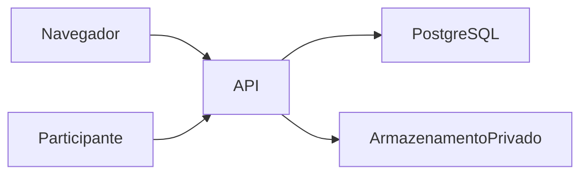

# Acessos, perfis e ativação

## Matriz do MVP

A API verifica sessão, vínculo ativo e empresa ativa em cada rota de cliente. `ADMIN` e `READER` são perfis de vínculo. As capacidades abaixo acrescentam operações específicas. Unidade e setor são recortes de consulta dentro da empresa. O servidor verifica se pertencem à empresa, e o vínculo atual autoriza o acesso no nível da empresa.

| Perfil de uso                           | Telas e operações permitidas                                                                                                                                                                                                                                                                                                                 | Anexos e exportações                                                                                                                                                                                                 |
| --------------------------------------- | -------------------------------------------------------------------------------------------------------------------------------------------------------------------------------------------------------------------------------------------------------------------------------------------------------------------------------------------- | -------------------------------------------------------------------------------------------------------------------------------------------------------------------------------------------------------------------- |
| Administração ReTech+                   | `READ_OVERVIEW` libera **Administração da plataforma**, com contagens globais e catálogo por empresa. `MANAGE_CLIENTS` permite corrigir o catálogo. `MANAGE_GRANTS` permite gerir concessões globais. As rotas de cliente exigem vínculo e permissões próprios.                                                                              | `READ_OVERVIEW` libera emissão, prévia e download do relatório global. A projeção global contém contagens e dados do catálogo.                                                                                       |
| Administração da empresa                | `ADMIN` na empresa ativa permite gerir cadastros básicos, grupos, acessos, instrumentos e coletas conforme o estado de cada recurso. Pode consultar **Auditoria**. Capacidades técnicas e de RH são concedidas separadamente.                                                                                                                | Pode listar, baixar, anexar e arquivar evidências da empresa. Pode emitir, abrir e baixar relatório SST. Exportação de RH segue as capacidades abaixo.                                                               |
| SST                                     | Vínculo ativo permite consultar inventário, ações e resultados coletivos na empresa. `TECHNICAL_DECISIONS` permite operações técnicas, como avaliação, parecer de eficácia e encerramento, conforme o estado e as demais regras do recurso.                                                                                                  | Leitura de evidências e relatório SST seguem o vínculo. Envio e arquivamento seguem o papel administrativo ou a atribuição operacional, conforme a ação.                                                             |
| RH                                      | Vínculo ativo com capacidades explícitas. `HR_ANALYTICS_READ` permite indicadores, observadas as regras de produção. `HR_PROFILE_READ` ou `HR_PROFILE_MANAGE` permitem leitura de ficha, vínculo e férias. Remuneração exige `HR_COMPENSATION_READ` ou `HR_COMPENSATION_MANAGE`. Alterações exigem as capacidades de gestão correspondentes. | PDF de Gestão de Pessoas exige `HR_EXPORT` e `HR_ANALYTICS_READ`, com leitura de perfil para a seção nominal e leitura financeira para a seção de remuneração. Os resultados de coleta são coletivos também para RH. |
| Gestor                                  | `READER` na empresa permite acompanhar painel, riscos, ações e resultados coletivos. `EXECUTE_ASSIGNED_ACTIONS` permite atualizar a execução das ações atribuídas ao usuário.                                                                                                                                                                | Pode consultar evidências e relatórios SST da empresa. O executor pode anexar na ação atribuída. Arquivamento exige `ADMIN`.                                                                                         |
| Respondente                             | O convite de coleta autoriza abrir o formulário correspondente e enviar respostas enquanto a participação estiver disponível.                                                                                                                                                                                                                | A rota pública devolve o estado do envio. Resultados de gestão, fichas, evidências e PDFs exigem sessão e permissões próprias.                                                                                       |
| Auditor ou mentor com acesso de leitura | `READER` pode acompanhar o histórico de riscos e ações e consultar revisões autorizadas desses registros. A listagem geral **Auditoria** e o histórico de acessos exigem `ADMIN`.                                                                                                                                                            | Evidências e relatórios SST seguem o vínculo de leitura na empresa ativa.                                                                                                                                            |

Os resultados de coleta aplicam a política coletiva antes de retornar contagens e distribuições. A API de gestão disponibiliza resultados agregados. A API pública permite abrir e enviar com convite, sem rota de leitura individual. O relatório SST usa a mesma separação e referencia evidências sem incluir seus arquivos. A prévia e o download de PDF consultam as permissões atuais, inclusive após emissão. Consulte [Gestão de Pessoas e plataforma](GESTAO_PESSOAS_PLATAFORMA.md) e [contrato de ações e evidências](API_ACOES_EVIDENCIAS.md).

### Exemplos para o aceite de acesso

Use duas empresas fictícias e contas separadas para operador da plataforma, administrador do cliente, leitor, executor e RH. Confirme a resposta da API e a ausência de campos privados no corpo, além dos controles exibidos na interface.

| Cenário                                                                                      | Resultado esperado e evidência                                                                                                                                                                                                                                                                                                                                                |
| -------------------------------------------------------------------------------------------- | ----------------------------------------------------------------------------------------------------------------------------------------------------------------------------------------------------------------------------------------------------------------------------------------------------------------------------------------------------------------------------- |
| Operador com `READ_OVERVIEW` consulta o catálogo e tenta abrir ficha de cliente sem vínculo  | Catálogo agrega por empresa. Ficha exige autorização do cliente. [Integração de plataforma e RH](../apps/api/test/people-platform.integration.spec.ts).                                                                                                                                                                                                                       |
| Administrador local sem capacidade de RH consulta perfil, remuneração e relatório financeiro | O cadastro administrativo básico permanece acessível. A API exige as capacidades de RH para dados ampliados e exportação. [Integração de RH](../apps/api/test/people-platform.integration.spec.ts) e [integração de relatórios](../apps/api/test/reports.integration.spec.ts).                                                                                                |
| Executor envia evidência na ação atribuída e outra empresa tenta baixar                      | O download autorizado retorna os mesmos bytes e exige sessão. A outra empresa recebe 404 antes do acesso ao armazenamento. Arquivamento exige administrador. [Integração de execução](../apps/api/test/action-workspaces.integration.spec.ts).                                                                                                                                |
| Leitor abre histórico de ação e tenta listar a auditoria geral                               | O histórico operacional autorizado abre. A auditoria geral responde 403. [Integração de auditoria](../apps/api/test/audit.integration.spec.ts).                                                                                                                                                                                                                               |
| RH e gestor abrem resultado de grupo pequeno, resultado disponível e consolidação            | Os valores protegidos ficam ocultos. Cada sessão recebe a mesma projeção coletiva autorizada, sem os identificadores das respostas individuais. A prova é da API. A experiência com participantes e PDF integra o roteiro do piloto. [Projeção](../apps/api/test/assessments-projection.spec.ts) e [integração de coletas](../apps/api/test/assessments.integration.spec.ts). |
| Membro baixa PDF autorizado, depois tenta com empresa diferente ou vínculo revogado          | O download autorizado retorna PDF privado. As tentativas fora do escopo são recusadas, inclusive após a emissão. [Integração de relatórios](../apps/api/test/reports.integration.spec.ts).                                                                                                                                                                                    |

### Decisões para validação

Produto, Dados e SST precisam confirmar se gestores devem ter autorização limitada por unidade ou setor e se o auditor precisa de acesso de leitura à trilha geral. Validar também se a emissão SST deve permanecer disponível a todos os vínculos ativos. A matriz registra as regras atuais para orientar essa revisão. O aceite de acesso com dados reais depende da política de privacidade, retenção e descarte aprovada pela organização.

O [roteiro de aceite do ID 34](VALIDACAO_SST_RH.md) traz o inventário mínimo de dados, os casos fictícios de instrumento, consolidação, matriz e RH e o critério pendente em cada cartão.

## Ameaças e controles do P0

O escopo inclui as rotas de sessão, participação, administração, consulta e download. Na homologação, a API atende o navegador, persiste o histórico no PostgreSQL e entrega evidências de um armazenamento privado. As provas desta seção usam PostgreSQL e MinIO no loopback, com dados fictícios. As prioridades consideram impacto caso o controle falhe e a facilidade de repetir a tentativa por uma conta autenticada ou pela rota pública.

| Ameaça e prioridade                                     | Fronteira e impacto                                                                                                                 | Controle e evidência                                                                                                                                                                                                                                                                                                                                                                                                                         |
| ------------------------------------------------------- | ----------------------------------------------------------------------------------------------------------------------------------- | -------------------------------------------------------------------------------------------------------------------------------------------------------------------------------------------------------------------------------------------------------------------------------------------------------------------------------------------------------------------------------------------------------------------------------------------- |
| Leitura de dados de outro cliente · alta                | Uma conta interna altera IDs da empresa, da ação ou do arquivo. A exposição atingiria fichas e evidências privadas.                 | A API confere sessão, empresa ativa e vínculo, e localiza o recurso dentro do escopo. O teste de anexos tenta usar a sessão da outra empresa com os dois caminhos e confirma 404 antes de consultar o armazenamento. [Escopo da sessão](../apps/api/src/modules/identity/identity.service.ts) · [Teste de anexos](../apps/api/test/action-workspaces.integration.spec.ts)                                                                    |
| Reidentificação por grupos pequenos ou diferença · alta | RH ou gestão compara resultados de ciclos, totais e subconjuntos. Um recorte pequeno pode expor respostas individuais.              | A projeção oculta valores abaixo do limiar e resultados dedutíveis pela diferença. O teste de coletas verifica as duas sessões, um resultado protegido, um disponível e a consolidação, usando contratos estritos e IDs individuais conhecidos. A política de uso real segue para validação. [Projeção](../apps/api/src/modules/assessments/assessment-projection.ts) · [Teste de coletas](../apps/api/test/assessments.integration.spec.ts) |
| Uso indevido de convite ou repetição de envio · alta    | Uma pessoa tenta adivinhar, reutilizar ou repassar o código que dá acesso ao questionário. O envio indevido pode alterar os totais. | A rota pública limita tentativas, armazena o hash do convite e verifica prazo e consumo em transação. Uma repetição do mesmo envio tem confirmação idempotente. A entrega manual do código exige orientação ao responsável. [Fluxo e limites](../apps/api/src/modules/assessments/assessments.service.ts) · [Teste de participação](../apps/api/test/assessments.integration.spec.ts)                                                        |
| Exportação após revogação · alta                        | Uma pessoa conserva o ID do relatório e tenta abrir ou baixar depois de perder o acesso.                                            | A API revalida vínculo e capacidades na leitura e depois de gerar o PDF. O relatório SST contém referências de evidências, e o arquivo segue uma rota privada separada. [Serviço de relatórios](../apps/api/src/modules/reports/reports.service.ts) · [Teste de PDF](../apps/api/test/reports.integration.spec.ts)                                                                                                                           |
| Exposição ou alteração do histórico · alta              | Uma conta leitora tenta abrir eventos administrativos, ou uma alteração fica sem a revisão que registra sua autoria.                | A trilha geral exige `ADMIN`, o histórico operacional verifica escopo, e as operações testadas persistem revisão e auditoria juntas. A resposta usa campos explícitos. O teste recupera a revisão exata e confere o rollback quando o registro de auditoria falha. [Contrato de auditoria](API_AUDITORIA.md) · [Teste de histórico](../apps/api/test/audit.integration.spec.ts)                                                              |

O arquivamento preserva o histórico e pode manter o objeto privado. Prazo de retenção, descarte, restauração e responsabilidade pelo uso de dados reais precisam de aceite da organização. O modelo descreve os controles do aplicativo e as provas locais. A configuração em operação, a revisão com SST/RH e os procedimentos de recuperação têm validações próprias.

## Ativação e administração de vínculos — IDs 03 e 04

## Operação

Na empresa ativa, administradores abrem **Acessos**. A área possui membros, convites e histórico paginados. Leitores não têm acesso à gestão; o servidor também verifica tenant, vínculo ativo e papel em cada operação.

Ao gerenciar um membro, perfil/situação e capacidades são operações separadas. Ambas exigem justificativa. Desativar requer confirmação e mantém conta, autoria e vínculos com outras empresas. O último administrador ativo não pode ser removido, inclusive por solicitações concorrentes.

Administrador não recebe permissão técnica automaticamente. `TECHNICAL_DECISIONS` e `EXECUTE_ASSIGNED_ACTIONS` são concessões explícitas. Atribuição persistida e operações de execução delegada serão integradas no ID 13; esta entrega fornece a política, não escrita global de ações ao leitor.

## Convite individual

1. Informar nome, e-mail, perfil inicial, capacidades, validade de 1 a 168 horas e justificativa.
2. Entregar manualmente o link exibido uma única vez. Não há envio de e-mail nem autocadastro sem convite.
3. Conta nova define nome e senha de 12 a 256 caracteres; conta existente entra com sua própria senha antes de aceitar o vínculo. O convite nunca troca uma senha existente.
4. Reemitir invalida o link anterior. Revogar impede aceitação. Convite já utilizado não pode ser reutilizado.
5. Fechar o link ou navegar para outra seção descarta sua exibição. Não há recuperação do segredo; o gestor deve reemitir quando necessário.

O fragmento secreto é removido imediatamente da URL nas variantes com/sem barra. O código fica apenas em memória durante a ativação; não é persistido em localStorage/sessionStorage. Atualizar a página exige reabrir o link ou colar o código. A aplicação não envia o segredo no caminho/query HTTP, nem o inclui em listagens, histórico ou logs.

## Recuperação e consistência

Conflito de versão na edição mantém o rascunho e bloqueia reenvio até recarregar a versão atual. O gestor compara situação, perfil e capacidades antes de confirmar novamente. Não há sobrescrita silenciosa.

Convite indisponível retorna `409 ACCESS_INVITE_UNAVAILABLE`, sem revelar se expirou, foi consumido, revogado ou não existe. A interface descarta segredo/senha e orienta pedir reemissão. Conflito com vínculo já ativo continua `409 CONFLICT`. Sessão expirada remove o conteúdo privado; permissão perdida interrompe a gestão.

O histórico identifica autorizador, operação, justificativa e data. Segredos, senhas e conteúdo de arquivos não fazem parte desse histórico. Datas da interface usam o fuso do navegador; padronização no fuso organizacional pertence ao histórico unificado do ID 22.

## Contratos e segurança

Contrato executável: `packages/contracts/src/access.ts`. Contrato OpenAPI do módulo: `apps/api/src/modules/access/access.openapi.json`. Operação, migração aditiva, rollback e fronteiras de autorização: `apps/api/src/modules/access/README.md`.

As sessões antigas mantêm seu DTO estrito. Capacidades são consultadas separadamente em `GET /api/v1/auth/session-capabilities`. Não migrar autenticação para outro provedor. Cookies, Origin, isolamento e erros sanitizados permanecem no backend.

A migração mantém o schema expandido em um retorno de aplicação. Versão anterior que ignora inativação não é retorno seguro para acessos: preservar os controles desta versão ou suspender acesso autenticado até correção por avanço. Não executar down destrutivo/reset de banco.

## Limites desta entrega

Sem SMTP, recuperação de senha, SSO, diretório global de contas ou poderes técnicos implícitos. Sem mudança em Render, Neon ou Supabase. A correção do storage online permanece no ID 19; acabamento de dashboard/aba nos IDs 24/27; divergências preexistentes de FKs no ID 31. Não foram alterados pacotes de membros ou tutoriais de commit.

Resultados e evidências locais estão em `VERIFICACAO_ID03_ID04.md`.
